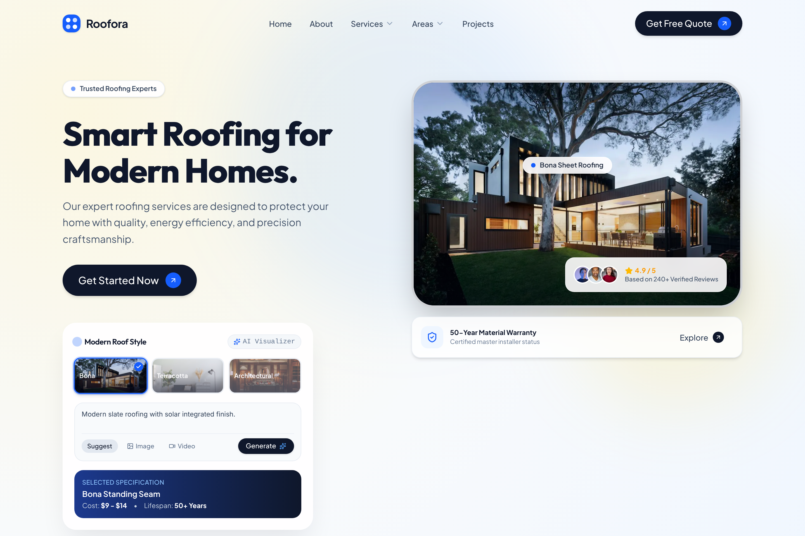
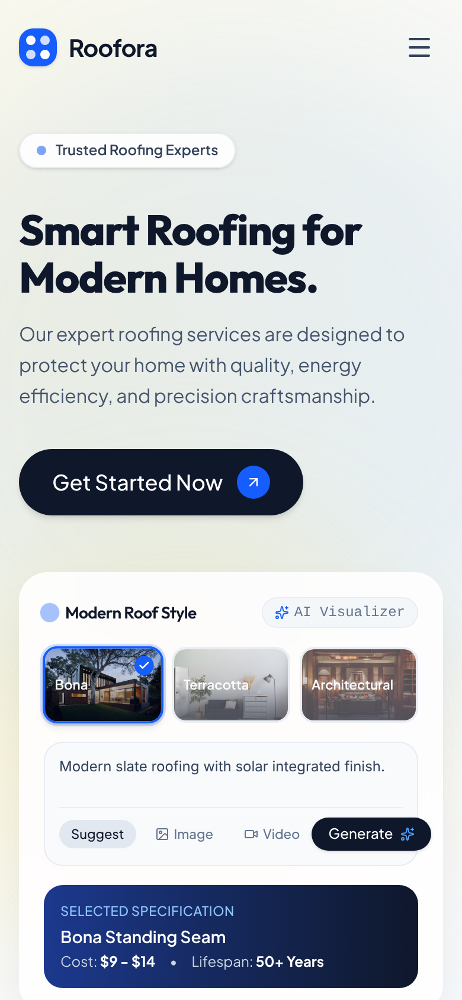
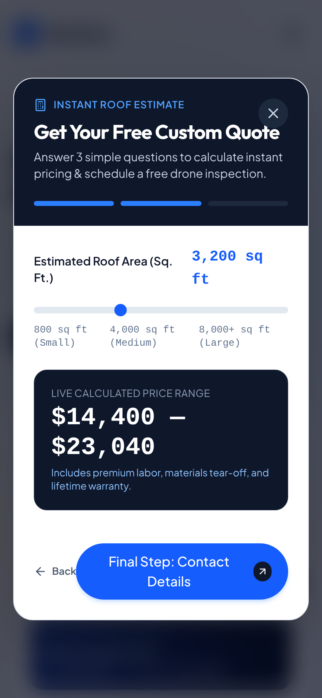
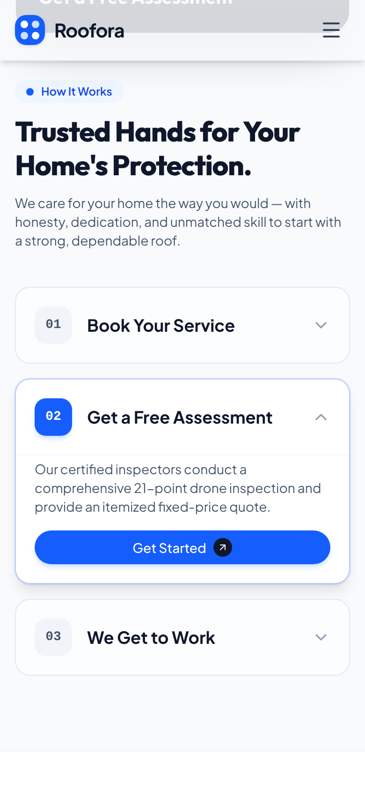

# Roofora

Roofora is a one-page marketing website for a small roofing company, built for homeowners and property owners who need a repair, a replacement or an inspection and want to know roughly what it will cost before they pick up the phone. It is a self-initiated concept. I first designed it as a Dribbble shot, then turned it into a working, responsive site.

| | |
|---|---|
| **Design** | Fraol Tamrat: research, concept, visual system, UX and content structure |
| **Development** | Claude Code, working from my design and under my direction |
| **Client** | Self-initiated concept (fictional roofing brand) |
| **Stack** | Next.js 16 (App Router), React 19, TypeScript, Tailwind CSS 4, Framer Motion, Lucide icons |

## Screenshots



<p>
  
  
  
</p>

*From left: the home page, the quote estimator with a live price range, and the three-step How It Works section, all at phone width.*

## The brief

The site is for a small, local roofing business that does residential and commercial work. The quote form asks visitors to choose between residential, commercial and multi-family properties, and the content is set in the Odessa and Midland area of West Texas.

The people coming to a site like this usually have a problem with their roof, or are planning a new one. They are not roofing experts. They want three things fast: to trust the company, to understand their options, and to get a sense of the price. The design had to answer all three on one page and make asking for a quote the obvious next step from anywhere on it.

## The concept

**Smart roofing for modern homes.** The headline is the idea. Roofing usually looks heavy and industrial online. I wanted Roofora to feel as light and clear as a modern home product, with confident photography of contemporary houses and an interface that floats on top of it.

The rules that follow from that:

- **Colour.** A near-white canvas (`#f8fafc`) with deep slate ink (`#0f172a`) for type and primary buttons. There is one brand colour, a strong blue (`#2563eb`), used for accents, progress and active states. A faint warm amber glow in the hero gradient suggests sunlight on a roof. The footer drops to a near-black (`#090d16`) so the page has a clear end.
- **Type.** Two sans serifs. Outfit, set extra-bold and tightly tracked, for headlines. Plus Jakarta Sans for body copy and the interface. Small pill labels above each section ("Who We Are", "How It Works") give the page a steady rhythm.
- **Shape.** Everything is soft. Buttons are full pills, cards have 24px to 40px corners, and the photos sit in the same rounded frames as the cards so imagery and UI read as one system.
- **Surface.** Translucent "glass" panels with background blur hold the floating widgets, the rating badge and the scrolled header. They let the photography show through instead of boxing it in.
- **Layout.** A 12-column grid inside a 1280px container, with asymmetric splits (6/6 in the hero, 5/4/3 in About, 5/7 in Projects) so the page doesn't settle into identical rows of cards.

What the system leaves out is as deliberate: no second brand colour competing with the blue, no serif or display face, no hard corners, and no colour-filled icons. Icons are thin line icons in slate or blue.

## Design decisions

**Price before personal details.** The quote estimator asks about the property and the service first. Then the visitor sets their roof area on a slider and sees a price range update live. Contact details come last. Someone who has already seen a number has a reason to hand over their phone number, and the three-segment progress bar shows how little is left to do.

**A roof style picker in the hero.** The "Modern Roof Style" card lets visitors switch between standing-seam metal, clay tile and architectural shingle and see each option's cost per square foot and expected lifespan. It turns the first screen from a promise into something to try, and it starts educating people about materials before they talk to anyone.

**One action, everywhere.** Every section ends with the same move: get a quote. The header, hero, About card, Projects, each How It Works step and the closing banner all open the same estimator. A visitor never has to scroll back up to find the next step, whichever section convinced them.

**The process as a guided sequence.** How It Works is an accordion of three numbered steps: book, get an assessment, we get to work. Opening a step swaps the photo beside it and shows a "Get Started" button inside that step. Only one step is open at a time, so the section reads as a short sequence instead of a wall of text.

**Two button types, clearly ranked.** Primary actions are dark slate pills with a small blue arrow disc. Secondary, in-flow actions are solid blue. Both use the same arrow, so anything clickable is recognisable at a glance and the strongest action on screen is always the darkest one.

**Proof next to the decision.** Trust signals sit right where visitors decide: a rating badge on the hero photo, a warranty card under it, stat cards beside the About copy, and a testimonial spotlight before the closing call to action. In this concept the proof itself is placeholder content (see Status), but its position in the layout is the point.

**Phone layouts designed, not just stacked.** On a phone the navigation folds into a menu with a full-width quote button. The testimonial side cards drop away, leaving the spotlight card and its arrows. In the estimator the option buttons sit on a grid that fits a thumb.

## How it was built

I designed the concept and the visual system as a Dribbble shot. I then wrote a brief for Claude Code: work from that design, write up the layout, tokens, components and interactions before writing any code, check open questions with me, and build the design tokens first and the components on top of them. Claude Code implemented the site in Next.js, Tailwind CSS and Framer Motion. I reviewed the result against my design.

## Status

**Finished**

- The full single page: header, hero, partner bar, About, Projects, How It Works, Testimonials, closing banner and footer
- Responsive layouts from phone to desktop, including the mobile menu
- The three-step quote estimator with a live price range and a confirmation screen
- The roof style picker, the How It Works accordion and the testimonial carousel
- The production build and type check both pass

**Placeholder or pending**

- **All business content is placeholder.** The phone number, email address, service area, the "HAAG Certified" and insurance claims, and every statistic (100K+ users, 825+ projects, 4.9 from 240+ reviews, 92%, 98%, 90% energy reduction) are invented for the concept. So are the testimonials and the people quoted.
- **The partner bar uses real manufacturer names** (GAF, CertainTeed, Owens Corning). These are placeholders and would have to be replaced before any real use.
- **Photos are Unsplash stock images**, loaded from Unsplash's servers. Two of the roof style swatches (Terracotta and Architectural) currently show interior photos rather than roofs.
- **Nothing is sent anywhere.** The quote form and the newsletter sign-up only show a success state. The price range is a simple illustrative formula ($4.50 to $7.20 per square foot), not real pricing.
- **The "AI Visualizer" is a mock-up.** "Generate" cycles to the next preset style, and the Image and Video tabs do nothing yet.
- The Services links point to a section that doesn't exist yet. The service-area entries aren't links, and the Privacy, Terms and Sitemap links go nowhere.
- Not yet done: reduced-motion support, Open Graph tags and a sitemap. GSAP is installed but not used yet.
- `npm run lint` currently reports 8 errors (unescaped quote characters in JSX) and 20 unused-import warnings.

## Run it locally

**Prerequisites:** Node.js 20.9 or later, and npm. The site loads its photos from `images.unsplash.com`, so you need an internet connection for the images to show.

```bash
npm install
```

```bash
npm run dev
```

Then open http://localhost:3000.

| Command | What it does |
|---|---|
| `npm run dev` | Start the development server on port 3000 |
| `npm run build` | Create a production build |
| `npm run start` | Serve the production build |
| `npm run lint` | Run ESLint |

```
app/
  layout.tsx          Fonts (Outfit, Plus Jakarta Sans) and page metadata
  page.tsx            The single page; holds the quote modal's open state
  globals.css         Colour tokens, glass surfaces, marquee animation
components/
  layout/             Header and Footer
  sections/           Hero, PartnerBar, About, Projects, HowItWorks, Testimonials, CtaBanner
  ui/                 Button, QuoteModal (estimator), RoofStyleWidget
lib/utils.ts          Class-name helper (clsx + tailwind-merge)
docs/screenshots/     Images used in this README
```
